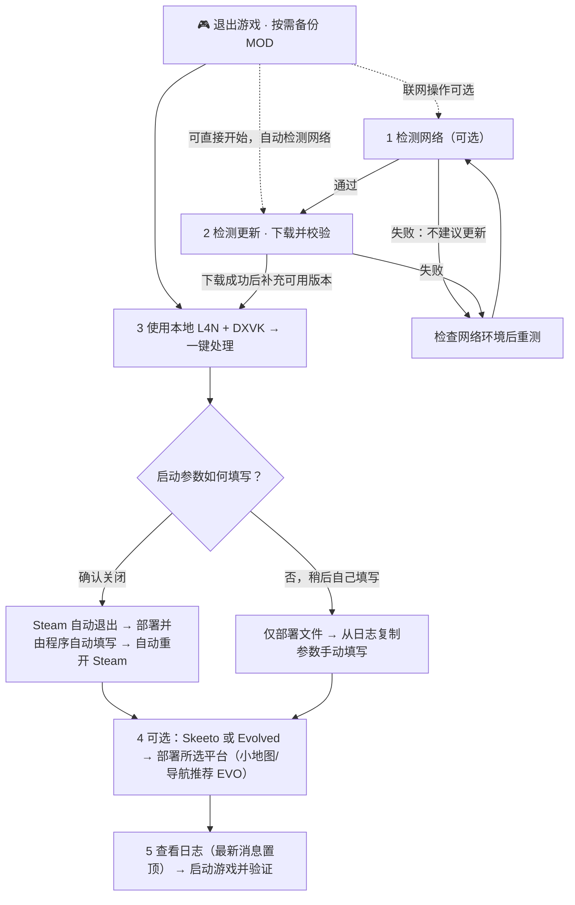

如果检查更新功能未正常工作，则请自备魔法使用。

# 使用教程

## 新界面操作顺序



1. **离线可直接用，1 / 2 联网操作可选**：随包资源和已完整下载的本地版本不要求联网检查，打开程序即可选择。需要补充版本时，可先“检测资源网络”，也可直接“检查最新版并下载”（未通过网络检测时会自动检测）。网络失败不影响已有本地版本的部署。
2. **3 基础部署**：选择本地 L4N、DXVK → 一键处理。版本列表从新到旧排列，默认选择顶部项；相同版本按资源文件修改时间排序，无法识别版本号的旧资源放在后方。部署前仍做本地包结构／完整性检查，不要求联网认证。启动项选“确认关闭”自动处理，选“否”不动 Steam 配置，稍后从日志复制参数。
3. **4 可选增强**：随包或缓存完整的 EVO／Skeeto 自动加载，优先选 EVO；仅 Skeeto 就绪时选 Skeeto。确认选择后 → **部署所选平台**（互斥，先有完整 L4N＋DXVK）；自动开启小地图与导航。新平台包和必需载荷全部下载成功后才切换到新版本，失败时保留完整旧版。
4. **Skeeto 工坊**：检查更新时就准备两项原始 VPK；部署时从缓存复制到游戏工坊目录、启用对应 MOD 并尝试订阅。清理 Skeeto 后退订；订阅未获确认时弹窗提示。Steam 仍可能校验或同步文件。
5. **更换/移除与日志**：两个清理按钮不依赖网络和更新检测，只需没有其他进行中的任务（仍需退出游戏，基础清理前需先清理增强平台）。5 日志区最新消息显示在顶部，磁盘日志仍按发生顺序保存。

### 离线版本与联网补充

- **随包版本快照（2026-10-27）**：L4N 2.51.0、2.50.3；DXVK 3.1.1、3.1，以及 AMD 适配 2.3.1、async 2.0；Skeeto 2.2.4；EVO 1.2.5。Skeeto 必需的两个工坊载荷也随包提供。
- **更新不是部署前置条件**。网络检测通过后，更新检查会额外下载程序内置的 10 个 DXVK 和 5 个 L4N 历史版本中本地缺少的版本；原有实时最新版检查保持不变。内置历史列表是上述日期的快照，不冒充未来的完整历史列表。
- **不会重复下载完整缓存**：重启后直接读取本地文件；再次检查更新时跳过完整缓存和有效的同版本手动导入包。手动删除或损坏后可重新下载。下载先保存为隐藏临时文件，经长度、SHA256、压缩包和平台结构检查后才公开到版本选择。
- **下载源**：DXVK 历史包使用官方 GitHub Release；L4N 历史包由本项目 [V8.15 资源附件](https://github.com/STC214/L4D2Fix_DXVK_L4N_/releases/tag/V8.15) 托管，原始最新版仍从平台检查获取。完整链接、大小、哈希见 [`resource_catalog.json`](../cmd/l4nfix/resource_catalog.json)。
- 网络检测为接口和下载链路抽样，不保证之后的速度或稳定性。历史批量下载要求本次程序中的网络检测通过；检测失败时仍会尝试原有各来源检查，已有资源保留。

### Steam 与 Skeeto 工坊

- **下载前移**：检查更新时复用已下载的 Skeeto 平台包原始字节，并额外下载预设素材包，缓存于 `resources/skeeto_mods`。两项均校验成功后才提供 Skeeto 部署选项；缺少缓存或缓存损坏时提示重新检查更新，不在部署时临时下载。
- **部署预置**：保留缓存，复制为 `left4dead2/addons/workshop/3782512354.vpk` 和 `3787239937.vpk`，仅将 `left4dead2/addonlist.txt` 的对应两项设为 `1`，其他 MOD 的开关、顺序和注释保留。Skeeto 的工坊文件实际是 ZIP 更新载荷，放入游戏时保留原字节与 `.vpk` 名称，不重新打包。
- **不伪造 Steam 状态**：不修改 `appworkshop_550.acf` 或 Steam 账户配置来冒充已下载。预置能减少进游戏后的下载等待，但 Steam／游戏仍可能校验或重新同步；不保证以后不再下载。清理时还原／移除本工具管理的这两个 VPK，只恢复对应两项开关，保留清理前其他 MOD 的后续修改。

- 素材包：[3782512354](https://steamcommunity.com/sharedfiles/filedetails/?id=3782512354)；Skeeto：[3787239937](https://steamcommunity.com/sharedfiles/filedetails/?id=3787239937)。仅操作本机 Steam 当前登录账号的这两项，不改其他订阅。清理 Skeeto 会取消这两项订阅，**包括之前已手动订阅的情况**；清理 Evolved 或基础部署不触碰订阅。
- 自动订阅/退订使用游戏自带的 x86 Steamworks DLL，由隔离辅助进程调用 `ISteamUGC` 并核实订阅状态。需要已登录 Steam、拥有游戏、接口兼容及联网正常；旧 DLL 缺接口时打开页面供确认。**页面打开不等于订阅成功，订阅成功也不等于下载完成。** 不读取密码、Cookie，不自动登录，不伪造本地订阅记录。
- 订阅交给 Steam 下载和维护工坊资源，不代表本工具会自动覆盖已部署的 DLL；平台自带更新机制能否应用以其运行结果为准。仍可用本工具检查更新、清理、重新部署。
- 自动填写启动项会请求 Steam **正常退出**，不强杀进程；退出超时即停止部署。部署结束后请求重开 Steam；中途失败也会尝试恢复原先运行状态。选手动填写则不关闭、不重开 Steam、不写启动配置。

## 两套独立部署

| 按钮 | 作用 |
|---|---|
| 检测资源网络 | 独立检测更新接口与实际资源下载链路，逐项记录通过、失败原因及耗时；不下载完整资源。 |
| 检查最新版并下载 | 可选联网操作：保留实时最新版检查；网络检测通过后补充内置 10 个 DXVK／5 个 L4N 中本地缺少的版本。成功才加载，不影响已有离线资源。 |
| 一键处理 | 部署 L4N＋所选 DXVK，备份原文件；确认关闭 Steam 后自动写 AppID 550 启动项，或选择手动填写。 |
| 一键清理 | 按 `.l4n_auto_backup/manifest.json` 恢复基础补丁和 Steam 配置；仍有增强平台时提示先清理增强平台。 |
| 部署所选平台 | 使用检查成功的最新版 Skeeto 或 L4D2Evolved，独立备份到 `.platform_auto_backup`，不修改基础部署清单与启动参数。 |
| 清理已部署平台 | 恢复平台原文件、移除本工具新增文件，不按最新版下载包猜测删除，不笼统清空平台目录。 |
| 备份 MOD | 备份 `left4dead2/addons` 到 `resources/addons_backup`，并备份 `left4dead2/cfg/video.txt`。 |
| 恢复 MOD | 恢复 MOD 和视频设置，同名文件覆盖。 |
| 系统字体/游戏默认 | 一键处理后切换 `left4dead2/neko/config.vdf` 的 font 配置块。 |
| 刷新版本 | 读取游戏磁盘上的 DXVK、L4N、EVO 和 Skeeto 已安装信息，显示于 3 / 4 区；区分版本未知、部署不完整、仅残留或两个平台核心共存，并重新核实基础部署。与联网检查更新是不同功能。 |
| 使用说明（在线） | 打开项目仓库的 `docs/使用教程.md`；发布包附带本教程为 `使用说明.md`。 |

手工安装、部署不全且没有本工具清单时，也可使用对应清理按钮：确认后先留档，再清理能确认归属的残留；未知共享文件保留并记入日志。Skeeto 2.x 使用根目录 `skeeto.dll` 与 `bin/wininet.dll`；Evolved 使用 L4N 插件目录，不叠加备用 `winmm.dll` 或附带渲染 DLL。

### 小地图和导航

#### <span style="color: red">想要更方便的使用小地图和导航功能推荐Evolved</span>

- Skeeto：向 `left4dead2/cfg/autoexec.cfg` 添加带标记的 `skeeto_nav 1` 块，保留现有命令。<span style="color: red">之后进入每一关地图需要输入skeeto_nav 1 、skeeto_nav_reload 两条命令到控制台才能正确使用小地图和导航功能。</span>
- Evolved：在 `Evolved/config.txt` 写入 `NoHmdMinimapEnabled=true`、`NoHmdWorldNavigationEnabled=true`；已有 `config2.txt` 时同步这两个键，保留其他设置。
- 文件部署完成不代表游戏运行效果已验收。Skeeto 默认 `[` 打开菜单，Evolved 默认 F8；需进图检查导航、换图、ESC、Alt-Tab 和分辨率变化。

#### Evolved 小地图窗口的位置和大小

以下设置依据 Evolved 1.2.5 的配置和静态代码检查，调整的是**小地图窗口**，不是整个游戏窗口。其他版本需重新核对配置含义。

**配置文件：**游戏根目录下的 `Evolved/config.txt`。例如：

```text
E:\SteamLibrary\steamapps\common\Left 4 Dead 2\Evolved\config.txt
```

先退出游戏并备份配置，再修改文件中已有的对应行；不要重复追加同名键，也不要覆盖其他个人设置。`config.sample` 中以 `#` 开头的内容只是注释样例，实际设置应写入 `config.txt`，行首不加 `#`。

##### 位置：按屏幕比例填写

```ini
NoHmdMinimapPosition=0.02 0.03
```

两个数值用**空格**隔开，不用逗号：第一个是从左向右的横向比例，第二个是从上向下的纵向比例。`0.02 0.03` 表示距左约 2%、距上约 3%。这是游戏渲染区域的比例，不是桌面坐标或像素值。

保持下面的原始比例尺寸时，可试用以下四角位置：

| 位置 | 配置行 |
|---|---|
| 左上角 | `NoHmdMinimapPosition=0.02 0.03` |
| 右上角 | `NoHmdMinimapPosition=0.77 0.03` |
| 左下角 | `NoHmdMinimapPosition=0.02 0.73` |
| 右下角 | `NoHmdMinimapPosition=0.77 0.73` |

以上是待游戏内检查的示例，不是插件内置预设。若同时使用右上角网络信息等 HUD，注意避开遮挡。

##### 大小：宽度比例与高度比例

```ini
NoHmdMinimapWidth=0
NoHmdMinimapHeight=0
NoHmdMinimapSize=0.210937634 0.236111075
```

`NoHmdMinimapSize` 的两个数值分别是宽度、高度占渲染区域的比例。上述值在 1280×720 下换算约为 **270×170 像素**，在 1920×1080 下约为 **405×255 像素**。实际窗口还受最小尺寸、边框和内部布局影响。

想缩小可尝试：

```ini
NoHmdMinimapSize=0.18 0.20
```

在 1280×720 下换算约为 230×144 像素。通常保留备用宽高项 `NoHmdMinimapWidth=0`、`NoHmdMinimapHeight=0`，先只调整比例尺寸。

位置与大小应一起考虑，尽量预留边距，使“横向位置比例＋宽度比例”和“纵向位置比例＋高度比例”均小于 1。改变尺寸、分辨率或窗口模式后，重新进入地图检查；不同宽高比下也需确认形状和 HUD 遮挡情况。

##### 应用与恢复

1. 完全退出游戏，备份 `config.txt`。
2. 先只修改位置，保存并重启游戏进入地图检查；确认后再调整尺寸。
3. 文本配置的运行时热重载尚未验证，因此这里采用退出游戏后修改、重新启动读取的流程。
4. 如需恢复本教程记录的原始位置与尺寸，只恢复以下四行，保留其他设置：

```ini
NoHmdMinimapWidth=0
NoHmdMinimapHeight=0
NoHmdMinimapPosition=
NoHmdMinimapSize=0.210937634 0.236111075
```

`NoHmdMinimapPosition=` 留空表示使用插件默认位置。若存在 `config2.txt`，先核对当前版本的读取和覆盖规则，不假定其优先级，也不要盲目把位置与尺寸重复写入多个文件。

代码存在鼠标拖动、记录位置变化及配置更新回调，但具体拖动入口和交互条件尚待游戏实测；暂不把“按 F8 后直接拖动”作为确定步骤。上述方法仅设置小地图窗口，不改变实景导航箭头的位置或地图 NAV 数据。

### 清理与历史版本

**无安装清单也能清理手动残留**：左侧“一键清理”处理 L4N＋DXVK，右侧“清理已部署平台”处理 Skeeto／Evolved；不必选择版本或补齐文件。确认后逐文件留档到 `resources/manual_cleanup_backups`，再处理已识别文件；私有目录里的个人设置也会留档后移除，共享文件内容不匹配时保留。清理完成后会弹窗提醒：**Steam 库 → 求生之路 2 → 属性 → 已安装文件 → 验证游戏文件的完整性**。校验完成前请勿启动游戏；异常资源或未确认残留见日志。留档内附 `rollback.ps1`，详细边界见 [手动残留清理与文件结构](手动残留清理与文件结构.md)。

**有本工具安装清单时**仍按独立清单还原，不影响 L4N＋DXVK、项目 C 或未托管文件。安装后发生变化的已托管文件先按 SHA256 留档到 `resources/platform_cleanup_backups`；清理 Skeeto 时只去掉 autoexec 中本工具的导航块，保留之后添加的其他命令。平台自行生成但未列入清单的个人配置和资源仍保留。备份损坏或文件锁定时保留清单供重试；损坏清单不自动切换为无清单模式。

历史 ZIP 保留在资源目录；当前界面按官方 API 本次返回的资源选择最新版，内部已预留按版本选择接口。清理始终按实际部署记录，而非当前下拉选项。不要手动删除备份目录。

## 联网更新与本地资源

- DXVK 来源：[doitsujin/dxvk 官方发布页](https://github.com/doitsujin/dxvk/releases?page=1)。通过 GitHub 官方 `releases/latest` API 检查最新稳定版，只下载 Windows `dxvk-版本.tar.gz` 附件，排除预发布、源码包和 dxvk-native。保留官方 TAR.GZ 格式，不把它改名为 ZIP。
- DXVK 下载后核对长度、官方 SHA256（API 提供时）、gzip 完整性、解压路径和唯一 x86 DLL 组合；成功后存入 `resources/dxvk` 并自动刷新选中。`resources/dxvk-index.json` 记录版本、附件 ID 和本地 SHA256；缓存损坏会重下，历史包保留。
- 检查更新只下载资源，不直接替换已部署文件。使用新 DXVK 仍按上述顺序清理并重新部署；“最新版”不等于对所有显卡最兼容，已有版本仍可手动选择。GitHub API 限流或网络错误会记入日志，稍后可重试。
- 使用 Steam 官方详情 API，核对工坊 ID、AppID 550、状态、内容 ID、更新时间和文件大小。实际下载地址取自本次 API 响应，不拼接地址，也不将快照直链当成永久地址。
- 三个工坊外层 `.vpk` 均实际为 ZIP。下载后验证长度、ZIP 成员 CRC、路径及解压限制、平台布局和 x86 DLL，再自动改为 `.zip` 并加载选项；失败下载不加入选项，不执行包内脚本。
- 本地索引 `resources/workshop-index.json` 保存下载元数据和 SHA256，再次检查会校验缓存；校验用于完整性与缓存比对，不代表第三方文件的安全背书。
- DXVK、L4N、Skeeto、Evolved 分别放在 `resources/dxvk`、`resources/l4n`、`resources/skeeto`、`resources/evolved`，旧目录与历史压缩包可以共存。
- 官方 L4N 包只有 `config_template.vdf` 时，部署阶段会生成 `config.vdf`。更新检查本身不修改游戏或配置；基础部署覆盖配置前，沿用原有 `resources/config_backups` 留档机制。
- 无公开直链时可用 Steam 订阅下载或离线包。网络失败查看日志；成功项保留，失败项不假报成功。
- 同一便携目录的多程序实例使用排他操作锁，避免下载、部署与清理并发。

## 原界面使用说明

使用步骤
1. 先关闭游戏；Steam 是否自动关闭由一键处理时的选择框决定
2. 在 DXVK版本 中选择要安装的版本
3. 点击 一键处理，程序会安装 L4N 基础文件和所选 DXVK
4. 需要保留 MOD 时，可先备份MOD，再恢复MOD
5. 系统字体/游戏默认：切换 config.vdf 中 font 配置块
6. 一键清理：按 .l4n_auto_backup 还原补丁和 Steam 配置
7. 更换dxvk和l4n版本需先清理再一键部署

版本来源
DXVK 放在 resources/dxvk，L4N 放在 resources/l4n。目录与压缩包、新旧版本统一存放。
支持 ZIP/TAR/TAR.GZ/TGZ；选择后解压到 resources/.package_tmp。
自动剥离外层目录、识别32位DLL并整理路径。
新增后重启刷新；缺失或多组关键文件会报错。
L4N 内文件名同时含启动/指令的 TXT 自动提取 Steam 参数。

Steam 启动项（内置回退）
-heapsize 2097152 -processheap -high -novid -nojoy -steam -lv -vulkan

验证
mat_info -> ShaderAPI: shaderapivk
mem_dump -> 2,048.00MB

自动识别游戏目录，备份原文件并安装所选补丁。

<!-- workshop-descriptions:begin -->

## 附录：Skeeto 与 Evo 工坊页面说明原文

> 以下原文复制自用户本地已保存的 Steam 官方详情 API `description` 快照（2026-10-25），不是本次成功读取的网页 HTML，也不声称是实时页面。仅调整标题、列表、链接与代码块排版，不改写说明正文。

> 原文中的兼容性、反作弊及安全性说法属于作者陈述，并非本工具的验证结论；原文的一般安装方式与本工具的独立部署路线有区别，使用本工具时以教程前文为准。

---

### Skeeto

**Mod 页面地址：** https://steamcommunity.com/sharedfiles/filedetails/?id=3787239937

<!-- source-description-sha256: d0230c9d7d90da4fee6abfe2537b8fccf4d528a83dc863de7dfa62de0a4636bf -->

Skeeto now supports English localization.

This is not a traditional mod — it will redefine what you thought was possible in Left 4 Dead 2.

Prepare to be amazed.


Skeeto保姆级安装教程：https://www.bilibili.com/opus/1258983063457628164
Bug反馈：bilibili @regoists

【Skeeto】

Skeeto 产品关键词：“正反馈”与“实用性”。在不破坏游戏平衡的前提下，优先提升反馈、局势可读性与操作确定性，解决原版诸多痛点。
**Core Philosophy: Server-Compatible · Highly Customizable · Positive Feedback · Practicality First** Improve feedback, readability and control without affecting game balance.

这不是传统意义上的 Mod。
Skeeto（SKT）是一个《求生之路 2》客户端增强框架。绝大多数功能运行于客户端，可在多数服务器直接使用，无需服主安装 VScript / SourceMod，不修改敏感游戏文件，不触发 LAC / VAC。功能默认关闭、相互隔离，支持独立开关、样式、方向键挪位及 JSON / 素材 DIY。进入禁用 Mod 的对抗服务器时会自动隔离全部功能。

**Skeeto (SKT) is a client-side enhancement framework for Left 4 Dead 2.** Most features work on regular servers without server-side VScript/SourceMod. Features are modular, disabled by default and highly customizable. They are automatically isolated on Mod-restricted competitive servers.

相比脚本包、服务器插件和资源硬替换，SKT 更强调：**联机可用、关闭无残留、反馈直接、配置可保存。**
Compared with scripts, server plugins or hard asset replacement, SKT focuses on **online compatibility, clean disabling, direct feedback and persistent configs.**

主菜单模块包括：命中反馈、准星、自定义 HUD、世界 HUD、Skeetoscript、Background Engine、Career Archive、客户端体验优化、本地服体验优化等。

━━━━━━━━━━━━━━━━━━━━
◆ 安装与更新 / Installation
━━━━━━━━━━━━━━━━━━━━

· **首次安装 / First install：**将工坊 `.vpk` 改为 `.zip` 并完整解压，包内所有文件拖入游戏根目录即可。
Rename the workshop .vpk to .zip and extract everything, then drag all files from the package into the game root directory.

· **更新 / Updates：**保持订阅即可，Skeeto 会自动更新。建议同时订阅官方预设素材包。
Keep the Workshop item subscribed; Skeeto updates automatically. The official preset asset pack is recommended.

· 安装异常优先检查游戏目录、杀毒拦截以及游戏是否已关闭。

━━━━━━━━━━━━━━━━━━━━
◆ 能力与优势 / Features
━━━━━━━━━━━━━━━━━━━━

【命中与击杀反馈 / Hit & Kill Feedback】

将 Hit / Kill / 爆头，以及空爆、断舌、Crown 等特殊击杀转化为可配置的图标、粒子和音效。普感与特感可分开配置，画面/音量独立控制；友伤仅真实掉血时触发。支持 JSON DIY，无需改源码即可新增反馈。

Configurable **hit, kill, headshot and special-kill feedback** such as skeets, tongue cuts and Crowns, using icons, particles and sounds. JSON-based custom presets are supported.

【自定义准星 / Custom Crosshairs】

静态准星使用高清外置叠加层；动态准星读取引擎实时散布；贴图准星支持 VTF、工坊与 DIY。三套可同时开启且互不影响。
Static overlay, real-time spread crosshair and VTF texture crosshair can be enabled independently or together.

【自定义 HUD / Custom HUD】

将队友状态、弹药、被控/救援、击杀统计与击杀列表、特感预警、开麦、导演压力、换弹/开火后摇、推击疲劳、治疗/投掷物计时、关卡进度、速度等拆成独立 HUD 模块。

全部可独立开关、调样式/大小，并用方向键挪位（Shift 大步）。把原版固定 HUD 变成一套由玩家自由组合的工具箱。

Modular HUD for **teammates, ammo, rescues, kill feed, infected warnings, Director pressure, reload/fire recovery, shove fatigue, item timers, map progress, speed and more.** Position, size and style are customizable.

【世界 HUD / World HUD】

将特感血条、伤害数字、技巧/击杀浮字、救援/解控、胆汁感染、黑白状态、惊扰警示等信息直接绑定实际角色模型，形成真正的三维世界 HUD。
3D HUD elements attached directly to world entities: infected health, damage numbers, kills, rescues, bile, incapacitation warnings and more.

【Skeetoscript】

将低血量红屏、治疗绿屏、空仓/低弹提示音、弹壳与弹匣落地等常见 VScript 视听增强改为纯客户端 C++ 实现。
Client-side C++ replacements for common VScript visual/audio enhancements, usable online without server scripts.

【Skeeto Background Engine】

突破原版主菜单仅支持 BIK 的限制。将 PNG / JPG、H.264 MP4 或 BIK 放入 `skeeto/backgrounds/` 即可使用，支持局内热切换、音量、显示模式与独立开关。
Custom main-menu backgrounds with **PNG/JPG, H.264 MP4 and BIK**, including hot switching and display/audio controls.

【Skeeto Career Archive】

直接在游戏内查看自己的 Steam 对局与生涯统计，方便总结与复盘。
View Steam match and career statistics directly in-game.

【客户端体验优化 / Client QoL】

包含投掷落点/轨迹预览、尸体/布偶瞬间隐藏（无需 `-lv`）、角色描边与强制客户端 CVar、听声辨位优化、闲置接管后视角/手电/武器槽恢复、Config Override、`skt_cvar`、L4N 内存清理、导演 HUD 常开等。

目标不是堆功能，而是解决实际游玩中反复出现的痛点。
QoL features include trajectory previews, instant ragdoll hiding, glow/CVar controls, positional-audio improvements, idle takeover fixes, config override, `skt_cvar`, L4N cleanup, Director HUD and more.

【本地服体验优化 / Local Server】

无需 SourceMod，即可为本地听服主机提供 Tick 解锁、NextBot 刷新率、0 lerp、空中加速 AA、单人闲置/去延迟、人物切换（类 `!csm`）、视角倾斜等功能。

这些功能**仅主机生效**，不作为远程服务器功能宣传。适合练枪、练特感、本地开黑与调手感。
Host-only tools for local servers: tick unlock, NextBot update rate, 0 lerp, air acceleration, idle/latency tweaks, character switching and view controls.

━━━━━━━━━━━━━━━━━━━━
◆ 使用说明 / Usage
━━━━━━━━━━━━━━━━━━━━

· 游戏内按 **[** 打开 Skeeto 菜单
Press **[** to open the Skeeto menu.

· 也可使用：`bind xxx skeeto_menu`

· 项目将持续维护，并保持纯公益性质。
Skeeto is continuously maintained and completely non-commercial.

· 问题反馈：bilibili @regoists

· 进入禁用 Mod 的对抗服务器时，会自动隔离全部功能，避免公平性风险。
All features are automatically isolated on Mod-restricted competitive servers.

Skeeto is designed to be compatible with other similar platforms by default (such as Left 4 Neko).

感谢使用 Skeeto。
**Hope Skeeto brings you the same satisfying feeling as landing a clean skeet.**

---

### L4D2Evolved（Evo）

**Mod 页面地址：** https://steamcommunity.com/sharedfiles/filedetails/?id=3785109042

<!-- source-description-sha256: 5a85bad6bc72c53ae096e731a4c7c280a066aca69f9267d1a88651e4af7fe8ba -->

#### Left 4 Dead 2: Evolved
L4D2 Evolved is a major enhancement project for Left 4 Dead 2. It integrates first-person body rendering, ADS, third-person aim correction, model switching, Mod management, MMD dancing, frame generation, and memory optimization. Most features can be configured in-game.

If pressing F8 does not open the menu after installation, you may have launched the game using a BAT file. Please launch the game directly through Steam instead, or download [L4N](https://steamcommunity.com/sharedfiles/filedetails/?id=3558049615) to bypass the built-in DLL injection launch method.

#### Main Features

##### First-Person Body & Ladders

- Displays your character body in first person, including torso and legs.
- Supports body position adjustment and an alternative B Mode for compatibility.
- Body rendering can be disabled while incapacitated or climbing.
- Includes built-in ladder body rendering and optional camera locking.


##### ADS, Sight Switching & Inspection
Includes an ADS system compatible with the animation standard used by [Aim Down Sight Addon [VScript]](https://steamcommunity.com/sharedfiles/filedetails/?id=3576501343). Compatible weapon Mods can provide ADS, sight switching, hybrid optics, magnifiers, and inspection animations.

- ADS, sight switching, and inspection can use separate keys, including mouse buttons and key combinations.
- Supports hold/toggle ADS and adjustable hold timing.
- Supports ADS FOV, laser/trajectory display, reload/shove ADS exit, and automatic ADS return.
- Supports reload, holster, draw, and inspection behavior when provided by the model.
- Single-player/local hosts use full ADS. Compatible Evolved hosts can provide server-side support.
- If server support is unavailable, Evolved uses local visual ADS. Spread, ammo, fire rate, and hit detection remain server-controlled.

**Weapon models must provide the required animations or Bodygroups. Evolved does not generate missing ADS or inspection animations, and the original ADS script does not need to run separately.**

##### Third-Person Aim & ALT Free Look

- Corrects crosshair and firing-direction mismatch caused by third-person camera offset.
- Hold ALT to freely look around while keeping the character's original aiming direction.
- Free-look sensitivity is adjustable.


##### Dynamic Crosshair & Combat Feedback

- Dynamic spread crosshair with adjustable size, spacing, center dot, and opacity.
- Melee weapons, throwables, and medical items use separate fixed crosshairs.
- Hit, kill, and headshot indicators plus hit/kill confirmation sounds.
- Visual and audio feedback can be configured separately.


##### Character, Weapon & Item Model Switching
Multiple replacement Mods for the same character, weapon, or item can coexist as selectable models.

- F7: character model menu.
- F4: current weapon/item model menu.
- Supports random player models on map changes and random weapon/item models on spawn.
- Weapons can replace only the first-person model while keeping third-person/world models.
- Optional model preloading reduces switching delays but increases memory use and loading time.

Model selection is local-only and does not send your installed model files to other players.

##### Model Parts & Materials

- F6 opens the parts/material panel.
- Switch model Bodygroups such as clothing and accessories.
- Hide parts/materials, adjust transparency, and save settings.
- Displays recognizable author-defined part names.


##### In-Game Mod Manager & Workshop Downloads

- F5 opens the Mod Manager with previews, search, categories, filters, and bulk enable/disable.
- Supports Mod/group priority, resource override checks, conflict detection, and issue reporting.
- Save and load Mod enable/disable presets.
- Enter Workshop Mod or collection links/IDs to download and install them directly.
- Supports download queues, pause, speed limits, update checks, and optional auto-update.
- Supports Steam downloads, CDN downloads, and HTTP/HTTPS proxy settings.
- Drag VPK, ZIP, 7Z, RAR, or folders containing VPK files into the game window to install local Mods.
- Supports FireAxe libraries.

After changing Mods or loading a preset, use “Apply and Refresh Game”. Some resources may still require a map change or restart.

##### MMD Dance Clones & Camera
Supports **MMD Dance Part3-1**, compatible dance resources, and dance packs generated by the project converter.

- Press P to open the song menu.
- Spawn a dancing clone at the crosshair position while continuing to move freely.
- Supports music, facial expressions, Camera Motion, and volume control.
- Supports camera-height adjustment for small-character dances.

Commands:

```text
!d z d01
```

Spawns dance d01 using the Zoey slot.


```text
!cam
```

Plays the included dance Camera Motion.


```text
!sd
```

Stops the dance.

**Dance motions, music, and camera data require the corresponding resource packs.**

##### DXVK & Desktop Frame Generation

- Optional built-in DXVK converts Direct3D 9 rendering to Vulkan.
- Asynchronous Shader/Pipeline compilation and caching reduce shader stutter.
- Supports 2x optical-flow desktop frame generation with NVIDIA and FidelityFX backends.
- Can use depth, camera motion, and supported object/bone motion vectors.

Frame generation requires compatible DXVK, GPU, and drivers. When enabled, the game renders real frames at half the display refresh rate and alternates them with generated frames. Disabled by default; enable it from F8.

##### Cache & Other Settings

- Expands DataCache to 2048 MB in the vanilla environment. Left4Neko keeps its own cache strategy when detected.
- Optional cache offloading moves idle mesh, animation, and audio data to a helper process to reduce game-process memory usage. Enabled by default.
- Option to keep game audio playing in the background.


#### Installation

1. Subscribe to this Workshop item, launch the game once, wait for Steam to finish downloading, then exit.
2. Open **left4dead2/addons/workshop/** and find **3785109042.vpk**.
3. Rename it to **3785109042.zip** and extract all files into the game folder containing **left4dead2.exe**.
4. Launch the game normally and press **F8** to open Evolved settings.


Game directory example:

```text
...\Steam\steamapps\common\Left 4 Dead 2
```


**Please remain subscribed.** When a new Workshop version is detected, Evolved will show an update prompt and update the files after confirmation.

#### Default Hotkeys

- **F8**: Evolved settings
- **F7**: Character models
- **F6**: Parts/materials
- **F5**: Mod Manager
- **F4**: Weapon/item models
- **P**: Dance menu
- **ALT**: Third-person free look

Menu and ADS keys can be changed in F8.

#### Compatibility Notes

- ADS, part switching, and dance features depend on installed models and resources.
- Built-in ADS/external ADS scripts and built-in ladders/Immersive Ladder are handled by feature toggles. Disable the built-in version before using an external implementation.
- Normal Direct3D 9 rendering remains supported. Desktop frame generation requires DXVK.
- When reporting issues, include the feature name, reproduction steps, and related Mods.

#### 简体中文对照

#### 《求生之路 2：Evolved》
L4D2 Evolved 是《求生之路 2》的大型增强项目，整合了第一人称身体显示、瞄准辅助（ADS）、第三人称瞄准修正、模型切换、MOD 管理、MMD 舞蹈、帧生成和内存优化。大多数功能可在游戏内配置。

如果安装后按 F8 没有打开菜单，可能是通过 BAT 文件启动了游戏。请改为直接通过 Steam 启动，或下载 [L4N](https://steamcommunity.com/sharedfiles/filedetails/?id=3558049615)，以绕过内置 DLL 注入启动方式。

#### 主要功能

##### 第一人称身体与梯子
- 在第一人称视角下显示角色身体，包括躯干和腿部。
- 支持身体位置调整，并提供用于兼容性的 B 模式。
- 倒地或爬梯时可以关闭身体渲染。
- 内置梯子身体显示，并可选择锁定镜头。

##### ADS、瞄具切换与检视
包含与 [Aim Down Sight Addon [VScript]](https://steamcommunity.com/sharedfiles/filedetails/?id=3576501343) 所用动画标准兼容的 ADS 系统。兼容的武器 MOD 可提供 ADS、瞄具切换、混合光学瞄具、放大镜和检视动画。
- ADS、瞄具切换和检视可分别绑定按键，包括鼠标按键及组合键。
- 支持按住或切换式 ADS，并可调整按住判定时间。
- 支持 ADS 视野、激光/弹道显示、换弹或推击时退出 ADS，以及自动恢复 ADS。
- 模型提供相应动作时，可支持换弹、收枪、掏枪和检视动作。
- 单人游戏和本地房主可使用完整 ADS；兼容的 Evolved 房主可提供服务器端支持。
- 若服务器端支持不可用，Evolved 会使用本地视觉 ADS；散布、弹药、射速和命中判定仍由服务器控制。

**武器模型必须提供所需动画或 Bodygroup。Evolved 不会生成缺失的 ADS 或检视动画，也不需要额外运行原始 ADS 脚本。**

##### 第三人称瞄准与 ALT 自由视角
- 修正第三人称镜头偏移造成的准星与射击方向不一致。
- 按住 ALT 可自由环视，同时保持角色原本的瞄准方向。
- 可调整自由视角灵敏度。

##### 动态准星与战斗反馈
- 动态散布准星，可调整大小、间距、中心点和不透明度。
- 近战武器、投掷物和医疗物品使用各自独立的固定准星。
- 提供命中、击杀和爆头提示，以及命中/击杀确认音效。
- 视觉与音频反馈可分别配置。

##### 角色、武器与物品模型切换
同一角色、武器或物品可同时安装多个替换 MOD，并作为可选模型共存。
- F7：角色模型菜单。
- F4：当前武器/物品模型菜单。
- 支持地图切换时随机选择玩家模型，以及生成时随机选择武器/物品模型。
- 武器可仅替换第一人称模型，同时保留第三人称/世界模型。
- 可选的模型预加载能减少切换延迟，但会增加内存占用和加载时间。

模型选择仅在本地生效，不会向其他玩家发送已安装的模型文件。

##### 模型部件与材质
- 按 F6 打开部件/材质面板。
- 切换服装、配件等模型 Bodygroup。
- 隐藏部件/材质、调整透明度并保存设置。
- 显示作者定义的易识别部件名称。

##### 游戏内 MOD 管理器与工坊下载
- 按 F5 打开 MOD 管理器，支持预览、搜索、分类、筛选及批量启用/禁用。
- 支持 MOD/分组优先级、资源覆盖检查、冲突检测和问题报告。
- 可保存和载入 MOD 启用/禁用预设。
- 可输入工坊 MOD 或合集链接/ID，直接下载并安装。
- 支持下载队列、暂停、速度限制、更新检查和可选自动更新。
- 支持 Steam 下载、CDN 下载及 HTTP/HTTPS 代理设置。
- 可将 VPK、ZIP、7Z、RAR 或包含 VPK 的文件夹拖入游戏窗口安装本地 MOD。
- 支持 FireAxe 库。

更改 MOD 或载入预设后，使用“应用并刷新游戏”。部分资源可能仍需切换地图或重启。

##### MMD 舞蹈分身与镜头
支持 **MMD Dance Part3-1**、兼容的舞蹈资源，以及由项目转换器生成的舞蹈包。
- 按 P 打开歌曲菜单。
- 可在准星位置生成跳舞分身，同时继续自由移动。
- 支持音乐、面部表情、镜头动作和音量控制。
- 可调整小体型角色舞蹈的镜头高度。

命令：`!d z d01` 使用 Zoey 槽位生成 d01 舞蹈；`!cam` 播放附带的镜头动作；`!sd` 停止舞蹈。

**舞蹈动作、音乐和镜头数据需要对应的资源包。**

##### DXVK 与桌面帧生成
- 可选内置 DXVK，将 Direct3D 9 渲染转换为 Vulkan。
- 异步着色器/渲染管线编译与缓存可减少着色器卡顿。
- 支持 NVIDIA 与 FidelityFX 后端的 2 倍光流桌面帧生成。
- 可使用深度、镜头运动及受支持物体/骨骼的运动矢量。

帧生成需要兼容的 DXVK、显卡和驱动。启用后，游戏以显示器刷新率的一半渲染真实帧，并与生成帧交替显示。该功能默认关闭，可在 F8 中启用。

##### 缓存与其他设置
- 在原版环境中将 DataCache 扩展到 2048 MB；检测到 Left4Neko 时沿用其自身缓存策略。
- 可选缓存卸载功能会将闲置网格、动画和音频数据转移至辅助进程，以减少游戏进程内存占用；该功能默认开启。
- 可设置游戏在后台运行时继续播放音频。

##### 安装
1. 订阅此工坊项目，启动游戏一次并等待 Steam 下载完成，然后退出游戏。
2. 打开 `left4dead2/addons/workshop/`，找到 `3785109042.vpk`。
3. 将其重命名为 `3785109042.zip`，并将全部文件解压到包含 `left4dead2.exe` 的游戏目录。
4. 正常启动游戏，按 F8 打开 Evolved 设置。

游戏目录示例：`...\Steam\steamapps\common\Left 4 Dead 2`

**请保持订阅。**检测到新的工坊版本后，Evolved 会提示更新，并在确认后更新文件。

##### 默认快捷键
- **F8**：Evolved 设置
- **F7**：角色模型
- **F6**：部件/材质
- **F5**：MOD 管理器
- **F4**：武器/物品模型
- **P**：舞蹈菜单
- **ALT**：第三人称自由视角

可在 F8 中更改菜单和 ADS 按键。

##### 兼容性说明
- ADS、部件切换和舞蹈功能取决于已安装的模型与资源。
- 内置 ADS 与外部 ADS 脚本、内置梯子与 Immersive Ladder 均通过功能开关管理。使用外部实现前，请先关闭内置版本。
- 支持普通 Direct3D 9 渲染；桌面帧生成需要 DXVK。
- 报告问题时，请附上功能名称、复现步骤和相关 MOD。

<!-- workshop-descriptions:end -->
